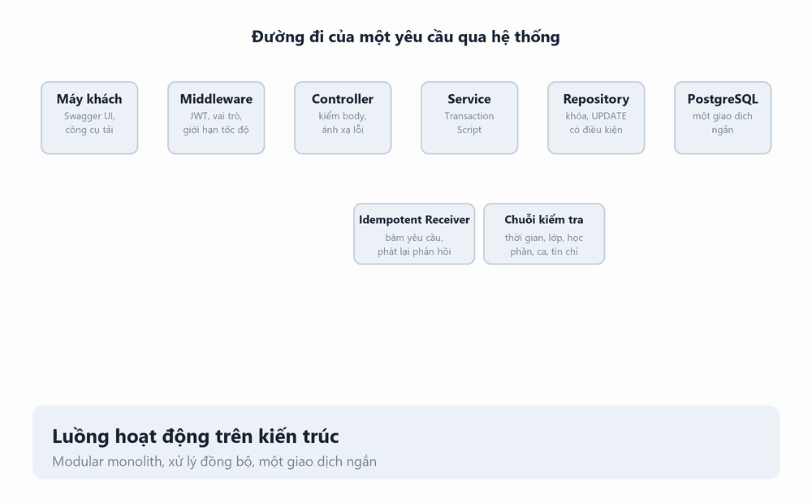
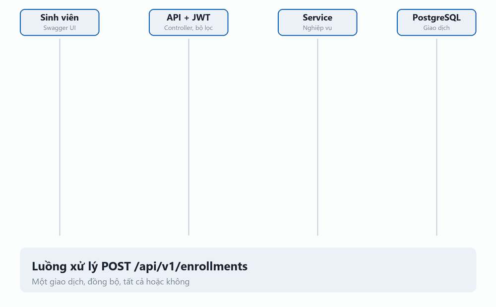
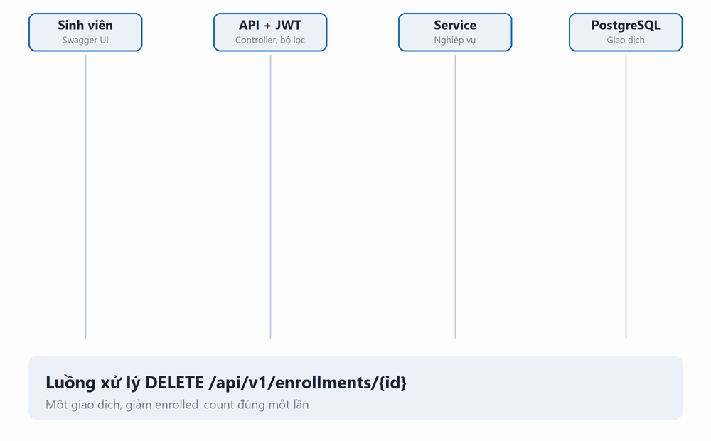
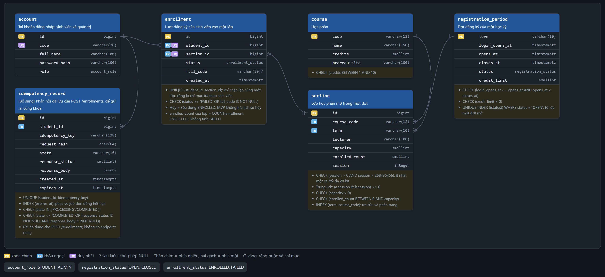

# Hệ thống đăng ký học phần VNU

Bài tập lớn môn Kiến trúc phần mềm.

## Giới thiệu

Backend đăng ký học phần. Hệ thống phải giữ đúng sĩ số, tránh đăng ký trùng khi nhiều sinh viên gửi yêu cầu đồng thời.

Dự án gồm hai pha:

- **Pha 1:** xây dựng hệ thống với chức năng cơ bản.
- **Pha 2:** cải tiến thuộc tính chất lượng, đánh giá trước và sau cải tiến.

## Phạm vi Pha 1

- Đăng nhập, phát JWT 60 phút.
- Xem thông tin bản thân, đợt đăng ký, danh sách lớp học phần và lượt đăng ký.
- Đăng ký một hoặc nhiều lớp trong một request theo nguyên tắc tất cả hoặc không; hỗ trợ Idempotency-Key.
- Hủy đăng ký.
- Quản trị cập nhật đợt đăng ký và lớp học phần.
- Kiểm tra sức khỏe dịch vụ.
- REST API, JSON, OpenAPI 3.x, Swagger UI. Không có giao diện riêng.

Chi tiết nghiệp vụ, ràng buộc và endpoint: [docs/phase-1-scope.md](docs/phase-1-scope.md).

## Kiến trúc và công nghệ

| Thành phần | Lựa chọn |
| --- | --- |
| Ngôn ngữ, framework | Java 17+, Spring Boot 3.5.7, Spring Security |
| Truy cập dữ liệu | Spring JDBC, data mapper |
| Cơ sở dữ liệu | PostgreSQL |
| Build | Maven Wrapper |
| Đóng gói | Docker, Docker Compose |
| Mạng | Tailscale; không mở Internet công cộng |

Phân tầng: API → nghiệp vụ → truy cập dữ liệu. Tầng nghiệp vụ không phụ thuộc Spring, HTTP hoặc JDBC. PostgreSQL là nguồn dữ liệu có thẩm quyền; hệ thống xử lý đồng bộ, không dùng Redis, hàng đợi hay worker.

Sơ đồ kiến trúc: [docs/diagrams/kien-truc.mmd](docs/diagrams/kien-truc.mmd).
Luồng đăng ký: [docs/diagrams/luong-dang-ky.mmd](docs/diagrams/luong-dang-ky.mmd).

### Luồng hoạt động trên kiến trúc

### Luồng đăng ký

Đăng ký nhiều lớp trong một giao dịch. Hệ thống khóa tài khoản và lớp theo thứ tự cố định, kiểm tra ràng buộc, cập nhật sĩ số rồi commit. Lỗi nghiệp vụ lưu phản hồi idempotency; lỗi nội bộ rollback toàn bộ.

### Luồng hủy

Hủy trong một giao dịch. Hệ thống chỉ hủy lượt của sinh viên đăng nhập và giảm sĩ số đúng một lần.

### Sơ đồ cơ sở dữ liệu

ERD tương tác: [docs/so-do-co-so-du-lieu.html](docs/so-do-co-so-du-lieu.html).

## Bảo mật

- API dùng filter xác thực và phân quyền; endpoint cá nhân cần JWT, endpoint quản trị cần vai trò ADMIN.
- GET registration và GET sections công khai trong mạng Tailscale; chỉ trả dữ liệu chung.
- Swagger UI và OpenAPI mở để thử API trong môi trường nhóm. API được bảo vệ vẫn cần JWT.
- Container chạy bằng user không phải root.
- JWT HS256 đã được triển khai qua `TokenGateway`. Khi `JWT_SECRET` trống, phát hoặc xác minh token trả 503 `AUTH_NOT_CONFIGURED`.

Chi tiết: [docs/system-security.md](docs/system-security.md) và [docs/k5-backend.md](docs/k5-backend.md).

## Chạy backend

Yêu cầu JDK 17+ và PostgreSQL có schema đã tạo bằng migration của nhóm. Spring Boot không tự nạp file `.env`; đặt biến môi trường trong shell hoặc IDE. `DB_URL`, `DB_USER` và `DB_PASSWORD` phải trỏ tới tài khoản API có quyền tối thiểu. `JWT_SECRET` phải là chuỗi ngẫu nhiên tối thiểu 32 byte.

Ví dụ PowerShell:

    $env:DB_URL = 'jdbc:postgresql://127.0.0.1:5432/dkhp'
    $env:DB_USER = 'dkhp_api'
    $env:DB_PASSWORD = '<mat-khau-cuc-bo>'
    $env:JWT_SECRET = (openssl rand -base64 48).Trim()
    .\mvnw.cmd spring-boot:run

- Swagger UI: http://127.0.0.1:8080/swagger-ui/index.html
- OpenAPI: http://127.0.0.1:8080/v3/api-docs
- Health: http://127.0.0.1:8080/api/v1/health; chỉ IP trong danh sách cho phép.

Maven Wrapper có lệnh kiểm thử và đóng gói:

    .\mvnw.cmd test
    .\mvnw.cmd package

Bộ kiểm thử dùng PostgreSQL tạm thời, không kết nối database triển khai. Yêu cầu Windows và giới hạn môi trường được ghi trong [docs/k5-backend.md](docs/k5-backend.md).

Docker Compose: `cp .env.example .env`, thay `POSTGRES_PASSWORD`, `DB_PASSWORD` và `JWT_SECRET` (API từ chối giá trị mẫu `change-me...`), rồi `docker compose up --build`. Lần đầu, PostgreSQL chạy hai script tạm trong [docker/initdb/](docker/initdb/): `v1__init.sql` tạo schema và `tmp2_roles.sh` tạo tài khoản API với quyền tối thiểu. Script chỉ chạy khi volume trống; sau khi sửa script, chạy `docker compose down -v` để dựng lại. Cấu hình này chưa được kiểm chứng end-to-end. Không commit file `.env`.

## Tài liệu

| Tài liệu | Nội dung |
| --- | --- |
| [docs/official-requirements.md](docs/official-requirements.md) | Đề bài và yêu cầu chính thức |
| [docs/phase-1-scope.md](docs/phase-1-scope.md) | Phạm vi, nghiệp vụ, API và ràng buộc |
| [docs/system-security.md](docs/system-security.md) | Phân tích bảo mật |
| [docs/open-decisions.md](docs/open-decisions.md) | Quyết định và vấn đề còn mở |
| [docs/k5-backend.md](docs/k5-backend.md) | Bàn giao backend, JWT, API và kiểm thử |
| [docs/diagrams/kien-truc.mmd](docs/diagrams/kien-truc.mmd) | Sơ đồ kiến trúc |
| [docs/diagrams/luong-dang-ky.mmd](docs/diagrams/luong-dang-ky.mmd) | Luồng đăng ký |
| [docs/diagrams/luong-huy.mmd](docs/diagrams/luong-huy.mmd) | Luồng hủy |
| [docs/so-do-co-so-du-lieu.html](docs/so-do-co-so-du-lieu.html) | ERD tương tác |

## Trạng thái

| Hạng mục | Trạng thái |
| --- | --- |
| Đề bài, phạm vi, sơ đồ và phân tích bảo mật | Có |
| Backend Spring Boot, API, giao dịch và idempotency | Có |
| Filter, phân quyền và giới hạn tốc độ | Có |
| JWT HS256 qua TokenGateway | Đã triển khai; cần cấu hình `JWT_SECRET` |
| Schema và tài khoản API cho Docker | Có bản tạm (`docker/initdb`); migration chính thức chờ bàn giao |
| Dữ liệu mẫu | Chưa |
| Maven Wrapper và bộ kiểm thử | Có |
| Docker Compose end-to-end | Chưa kiểm chứng |
| Kiểm thử tải trên Kaggle CPU | Chưa thực hiện |
| CI | Chưa cấu hình |
