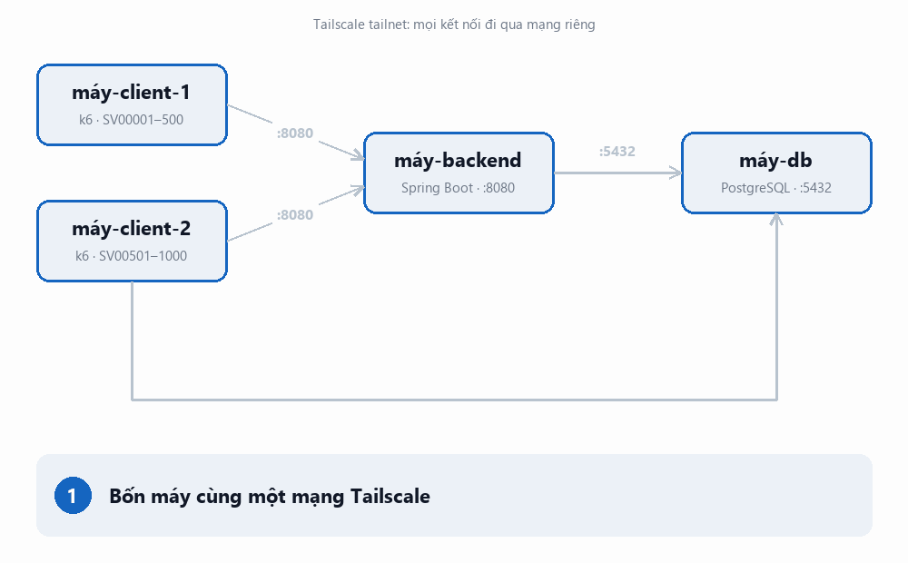

# Hệ thống đăng ký học phần VNU

Bài tập lớn môn Kiến trúc phần mềm.

## Giới thiệu

Backend đăng ký học phần. Hệ thống phải giữ đúng sĩ số, tránh đăng ký trùng khi nhiều sinh viên gửi yêu cầu đồng thời.

Dự án gồm hai pha:

- Pha 1: xây dựng hệ thống với chức năng cơ bản.
- Pha 2: cải tiến thuộc tính chất lượng, đánh giá trước và sau cải tiến. Bài toán: [docs/phase-2-scope.md](docs/phase-2-scope.md).

## Phạm vi Pha 1

- Đăng nhập, phát JWT 60 phút.
- Xem thông tin bản thân, đợt đăng ký, danh sách lớp học phần và lượt đăng ký.
- Đăng ký một hoặc nhiều lớp trong một request theo nguyên tắc tất cả hoặc không; hỗ trợ Idempotency-Key.
- Hủy đăng ký.
- Quản trị cập nhật đợt đăng ký và lớp học phần.
- Kiểm tra sức khỏe dịch vụ.
- REST API, JSON, OpenAPI 3.x, Swagger UI. Không có giao diện riêng.

Chi tiết nghiệp vụ, ràng buộc và endpoint: [docs/phase-1-scope.md](docs/phase-1-scope.md).

## Kiến trúc và công nghệ

| Thành phần | Lựa chọn |
| --- | --- |
| Ngôn ngữ, framework | Java 17+, Spring Boot 3.5.7, Spring Security |
| Truy cập dữ liệu | Spring JDBC, data mapper |
| Cơ sở dữ liệu | PostgreSQL |
| Build | Maven Wrapper |
| Đóng gói | Docker, Docker Compose |
| Mạng | Tailscale; không mở Internet công cộng |

Phân tầng: API, nghiệp vụ, truy cập dữ liệu. Tầng nghiệp vụ không phụ thuộc Spring, HTTP hoặc JDBC. PostgreSQL là nguồn dữ liệu có thẩm quyền; hệ thống xử lý đồng bộ, không dùng Redis, hàng đợi hay worker.

Mã nguồn sơ đồ (Mermaid): [kiến trúc](docs/diagrams/kien-truc.mmd), [luồng đăng ký](docs/diagrams/luong-dang-ky.mmd), [luồng hủy](docs/diagrams/luong-huy.mmd). Các GIF bên dưới là bản tóm tắt trực quan.

### Luồng hoạt động trên kiến trúc

### Luồng đăng ký

Đăng ký nhiều lớp trong một giao dịch. Hệ thống khóa tài khoản và lớp theo thứ tự cố định, kiểm tra ràng buộc, cập nhật sĩ số rồi commit. Lỗi nghiệp vụ lưu phản hồi idempotency; lỗi nội bộ rollback toàn bộ.

### Luồng hủy

Hủy trong một giao dịch. Hệ thống chỉ hủy lượt của sinh viên đăng nhập và giảm sĩ số đúng một lần.

### Triển khai bốn máy

Hướng dẫn từng bước: [docs/deploy-tailscale.md](docs/deploy-tailscale.md).

### Sơ đồ cơ sở dữ liệu

ERD tương tác: [docs/so-do-co-so-du-lieu.html](docs/so-do-co-so-du-lieu.html).

## Bảo mật

- API dùng filter xác thực và phân quyền; endpoint cá nhân cần JWT, endpoint quản trị cần vai trò ADMIN.
- GET registration và GET sections công khai trong mạng Tailscale; chỉ trả dữ liệu chung.
- Swagger UI và OpenAPI mở để thử API trong môi trường nhóm. API được bảo vệ vẫn cần JWT.
- Container chạy bằng user không phải root.
- JWT HS256 đã được triển khai qua `TokenGateway`. Khi `JWT_SECRET` trống, phát hoặc xác minh token trả 503 `AUTH_NOT_CONFIGURED`.

Chi tiết: [docs/system-security.md](docs/system-security.md) và [docs/k5-backend.md](docs/k5-backend.md).

## Chạy backend

Yêu cầu JDK 17+ và PostgreSQL có schema đã tạo bằng migration của nhóm. Spring Boot không tự nạp file `.env`; đặt biến môi trường trong shell hoặc IDE. `DB_URL`, `DB_USER` và `DB_PASSWORD` phải trỏ tới tài khoản API có quyền tối thiểu. `JWT_SECRET` phải là chuỗi ngẫu nhiên tối thiểu 32 byte.

Ví dụ PowerShell:

    $env:DB_URL = 'jdbc:postgresql://127.0.0.1:5432/dkhp'
    $env:DB_USER = 'dkhp_api'
    $env:DB_PASSWORD = '<mat-khau-cuc-bo>'
    $env:JWT_SECRET = (openssl rand -base64 48).Trim()
    .\mvnw.cmd spring-boot:run

- Swagger UI: http://127.0.0.1:8080/swagger-ui/index.html
- OpenAPI: http://127.0.0.1:8080/v3/api-docs
- Health: http://127.0.0.1:8080/api/v1/health; chỉ IP trong danh sách cho phép.

Maven Wrapper có lệnh kiểm thử và đóng gói:

    .\mvnw.cmd test
    .\mvnw.cmd package

Bộ kiểm thử dùng PostgreSQL tạm thời, không kết nối database triển khai. Yêu cầu Windows và giới hạn môi trường được ghi trong [docs/k5-backend.md](docs/k5-backend.md).

Docker Compose: `cp .env.example .env`, thay `POSTGRES_PASSWORD`, `DB_PASSWORD` và `JWT_SECRET` (API từ chối giá trị mẫu `change-me...`), rồi `docker compose up --build`. Lần đầu, PostgreSQL chạy `v1__initdb.sql` để tạo schema và `v2__roles.sh` để tạo tài khoản API trong [docker/initdb/](docker/initdb/). Các script chỉ chạy khi volume trống; chúng không nâng cấp volume hiện hữu. Muốn dựng lại schema từ đầu, chạy `docker compose down -v` rồi `docker compose up --build`. Dữ liệu mẫu không tự nạp: chạy thủ công [docker/seed/seed_dev.sql](docker/seed/seed_dev.sql) theo hướng dẫn ở đầu file. CI dựng Docker Compose rồi kiểm tra nhanh đăng nhập, xác thực, đăng ký và gửi lặp; cấu hình chưa được kiểm trên bốn máy Tailscale. Không commit file `.env`.

## Tài liệu

| Tài liệu | Nội dung |
| --- | --- |
| [docs/official-requirements.md](docs/official-requirements.md) | Đề bài và yêu cầu chính thức |
| [docs/phase-1-scope.md](docs/phase-1-scope.md) | Phạm vi, nghiệp vụ, API và ràng buộc |
| [docs/system-security.md](docs/system-security.md) | Phân tích bảo mật |
| [docs/open-decisions.md](docs/open-decisions.md) | Quyết định và vấn đề còn mở |
| [docs/k5-backend.md](docs/k5-backend.md) | Bàn giao backend, JWT, API và kiểm thử |
| [docs/dkhp-erd/database-design.md](docs/dkhp-erd/database-design.md) | Schema PostgreSQL, quyền DB và bất biến dữ liệu |
| [docs/API-SPECIFICATION.md](docs/API-SPECIFICATION.md) | Đặc tả 10 endpoint, mã lỗi, idempotency |
| [docs/openapi.yaml](docs/openapi.yaml), [docs/openapi.json](docs/openapi.json) | OpenAPI 3.1.0 sinh từ ứng dụng, import được vào Postman hoặc Swagger Editor |
| [docs/diagrams/kien-truc.mmd](docs/diagrams/kien-truc.mmd) | Sơ đồ kiến trúc |
| [docs/diagrams/luong-dang-ky.mmd](docs/diagrams/luong-dang-ky.mmd) | Luồng đăng ký |
| [docs/diagrams/luong-huy.mmd](docs/diagrams/luong-huy.mmd) | Luồng hủy |
| [docs/so-do-co-so-du-lieu.html](docs/so-do-co-so-du-lieu.html) | ERD tương tác |
| [docs/test-matrix.md](docs/test-matrix.md) | Ma trận kiểm thử TC01–TC14 và lệnh chạy lại |
| [docs/deploy-tailscale.md](docs/deploy-tailscale.md) | Triển khai bốn máy qua Tailscale |
| [load/README.md](load/README.md) | Kịch bản thử tải k6, kiểm thử đồng thời, cách chạy từ máy trống |
| [docs/load-test-report.md](docs/load-test-report.md) | Báo cáo thử tải trên một máy (Kaggle, laptop) |
| [docs/phase-2-scope.md](docs/phase-2-scope.md) | Bài toán pha 2 |
| [docs/demo-script.md](docs/demo-script.md) | Kịch bản trình diễn qua Swagger UI |

## Trạng thái

| Hạng mục | Trạng thái |
| --- | --- |
| Đề bài, phạm vi, sơ đồ và phân tích bảo mật | Có |
| Backend Spring Boot, API, giao dịch và idempotency | Có |
| Filter, phân quyền và giới hạn tốc độ | Có |
| JWT HS256 qua TokenGateway | Đã triển khai; cần cấu hình `JWT_SECRET` |
| Schema và tài khoản API cho Docker | Có script khởi tạo v1 cho DB mới (`docker/initdb`) |
| Dữ liệu mẫu | Có (`docker/seed/seed_dev.sql`), nạp thủ công |
| Đặc tả API và OpenAPI | Có |
| Maven Wrapper và bộ kiểm thử | Có |
| Docker Compose | CI dựng và kiểm tra nhanh; chưa kiểm trên bốn máy Tailscale |
| Ma trận kiểm thử, kịch bản thử tải k6, hướng dẫn triển khai, kịch bản trình diễn | Có |
| Kiểm thử tải | Đã chạy trên một máy (Kaggle, laptop); chưa chạy trên bốn máy Tailscale |
| `docker/verify/invariants.sql` (kiểm bất biến sau tải) | Có; chạy bằng `load/scripts/run_invariants.sh` |
| CI | Có (`.github/workflows/ci.yml`): kiểm thử Maven, dựng Docker Compose |
